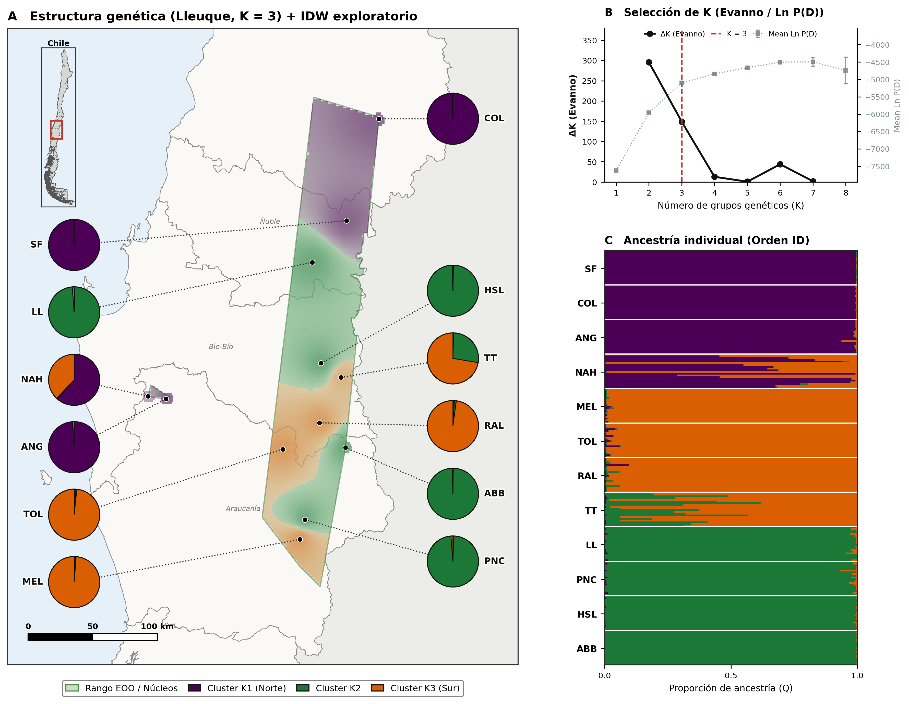
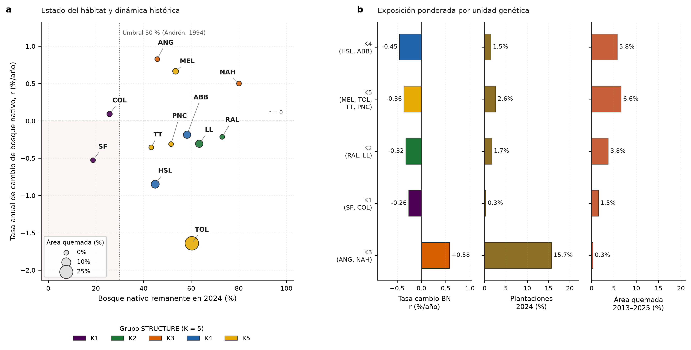

# Biodiversidad y Conservación Biológica (ByC 2026) — Evaluación Espacial UICN/RCE, Biodiversidad Local, Estructura Genética y Amenazas de Uso del Suelo

[](https://colab.research.google.com/github/magdzraw/byc-2026/blob/main/notebooks/BYC_Dist_AOO_EOO.ipynb)
[](LICENSE)
[](https://www.python.org/)

Repositorio abierto con las herramientas computacionales desarrolladas para las actividades prácticas y ayudantías de la asignatura **Biodiversidad y Conservación Biológica (2026)**, impartida en la **Facultad de Ciencias Forestales de la Universidad de Concepción (Chile)**.

* **Docente titular:** Dr. Rodrigo Hasbún Zaror
* **Ayudantía y desarrollo de herramientas:** Mauricio Aguirre-Díaz ([@magdzraw](https://github.com/magdzraw))
* **Especies arbóreas nativas de estudio:** Alerce (*Fitzroya cupressoides*), Araucaria (*Araucaria araucana*), Lleuque (*Prumnopitys andina*), Queule (*Gomortega keule*) y Ruil (*Nothofagus alessandrii*).

---

## ¿Qué permite hacer el cuaderno [`BYC_Dist_AOO_EOO.ipynb`](notebooks/BYC_Dist_AOO_EOO.ipynb)?

Diseñado para estudiantes sin experiencia previa en programación ni Google Earth Engine, ejecutable en un clic en **Google Colab** y totalmente interoperable con **QGIS**:

1. **Curaduría automatizada de ocurrencias (GBIF API v1 + terreno):** resolución automática de sinónimos mediante *GBIF Backbone* (`taxonKey`), filtrado de fósiles, ejemplares cultivados/introducidos, incertidumbre espacial ($\le 2000\text{ m}$), envolventes biogeográficas nativas e integración con las localidades de muestreo (`Coordenadas_codigo.csv`).
2. **Evaluación de Criterio B1 — Extensión de Presencia (EOO):** Polígono Convexo Mínimo (MCP) calculado en proyección equivalente (**LAEA *Equal-Area***), recortado con límites de alta resolución **GADM v4.1** (respaldo **Natural Earth 1:10m**), con selector entre escala nacional **RCE Chile (`CL`)** y **UICN Global (`CL` + `AR`)**, más núcleos biogeográficos disyuntos complementarios.
3. **Evaluación de Criterio B2 — Área de Ocupación (AOO):** grilla estándar obligatoria UICN/RCE de **$2 \times 2\text{ km}$ ($4\text{ km}^2$)** optimizada por desplazamiento de origen ($10 \times 10$ orígenes para hallar el mínimo de celdas según UICN v16 Sec. 4.10), acompañada de grilla fina complementaria de literatura ($1 \times 1\text{ km}$) para *Queule* (Plan RECOGE Queule, 2022) y *Ruil* (Plan RECOGE Ruil, D.S. 42/2020).
4. **Biodiversidad local de flora vascular acompañante (`Tracheophyta`):** malla hexagonal equivalente ($r = 2500\text{ m}$, $A_{\text{hex}} \approx 16{,}24\text{ km}^2$), consulta paginada a GBIF (`phylumKey = 7707728`) y cálculo de riqueza observada ($S_{\text{obs}}$), **Shannon-Wiener ($H'$)**, **Pielou ($J'$)**, **Gini-Simpson ($1 - D$)**, estimador **Chao1 ($\hat{S}_{\text{Chao1}}$)** y **cobertura de muestra ($\hat{C}$)**.
5. **Módulo 11 — Espacialización de estructura genética (`STRUCTURE`):** lectura directa del archivo `.zip` de la carpeta `Results/` de STRUCTURE, cálculo automático de **Evanno ($\Delta K$)** y $\text{Mean }\ln P(D) \pm \text{SD}$, selección manual o automática de $K$, consenso entre réplicas tipo CLUMPP (algoritmo húngaro), **figura compuesta de publicación (A + B + C)** a 300 dpi (PNG y SVG), mapa interactivo **Folium** con diagramas de torta SVG vectoriales (exportable a `.html`) y superficie exploratoria **IDW** opcional enmascarada.
6. **Módulo 12 — Diagnóstico de amenazas de uso del suelo e incendios (MapBiomas Chile, sin GEE):**
   * **Modo comunal automático (1999–2024):** integra las estadísticas oficiales de **MapBiomas Chile Colección 2.0** con límites comunales `GADM v4.1` para cuantificar composición del paisaje (Bosque Nativo, Plantaciones Forestales, Matorral, Agricultura/Pasturas, Infraestructura), trayectoria de 26 años, tasa anual compuesta de deforestación (Puyravaud, 2003), matriz exacta de transiciones `1999 → 2024` y respaldo cuantitativo del **Subcriterio B(b)(iii)** UICN/RCE.
   * **Modo ráster 30 m + MapBiomas Fuego Col. 1 (opcional *plug-and-play*):** acepta recortes GeoTIFF (`.tif` o `.zip`) descargados sin GEE desde MapBiomas Chile para extraer píxeles exactos en buffers multiescala (`2 km` y `7,5 km`) y celdas AOO ($2 \times 2\text{ km}$), incorporando superficie quemada, recurrencia de incendios (2013–2025) y año del último evento.
   * **Síntesis `STRUCTURE` × MapBiomas:** pondera la exposición a amenazas según las proporciones de ancestría ($Q$) para identificar las **unidades genéticas más vulnerables** y priorizar localidades de conservación.
7. **Exportación directa a QGIS:** genera un único GeoPackage (`.gpkg`, proyectado en UTM Chile `EPSG:32718`/`EPSG:32719`) con todas las capas vectoriales de distribución, biodiversidad, estructura genética y amenazas MapBiomas, además de mapas `.html`, tablas `.csv` y figuras a 300 dpi.





---

## Estructura del repositorio

```text
byc-2026/
├── notebooks/
│   ├── BYC_Dist_AOO_EOO.ipynb                                 # Notebook principal para estudiantes (Colab / Jupyter, sin GEE)
│   └── Preparar_Rasters_MapBiomas_GEE.ipynb                   # Notebook auxiliar docente para generar paquetes 30 m desde GEE
├── scripts/
│   └── descargar_mapbiomas_gee.py                             # Script automatizado de descarga por tiles y unión en mosaico 30 m
├── data/
│   ├── Coordenadas_codigo.csv                                 # Localidades de referencia y códigos cortos (5 especies)
│   ├── Results_lleuque.zip                                    # Ejemplo real de salidas de STRUCTURE (K = 1..8, 24 corridas)
│   ├── mapbiomas_chile_col2_cobertura_comunal_1999_2024.csv.gz   # Cobertura anual oficial MapBiomas Chile Col. 2.0 (CC BY 4.0)
│   └── mapbiomas_chile_col2_transicion_comunal_1999_2024.csv.gz  # Transiciones comunales MapBiomas Chile Col. 2.0 (CC BY 4.0)
├── assets/
│   ├── figura_structure_lleuque_K3.png
│   ├── ejemplo_figura_lleuque_K5.png
│   └── ejemplo_mapbiomas_riesgo_lleuque.png
├── requirements.txt                                           # Dependencias Python
├── CITATION.cff                                               # Metadatos estándar de citación académica
├── LICENSE                                                    # Licencia MIT
└── README.md
```

---

## Inicio rápido

1. Haz clic en el botón **Open in Colab** al inicio de este README.
2. En la **Sección 2**, selecciona la especie (`Alerce`, `Araucaria`, `Lleuque`, `Queule` o `Ruil`) y la escala (`RCE_CHILE` o `UICN_GLOBAL`).
3. *(Opcional)* En la **Sección 11.1**, activa `ACTIVAR_MODULO_STRUCTURE` y sube tu `.zip` de `Results/` (si no subes archivos, el notebook descarga automáticamente los archivos de ejemplo desde este repositorio para probar el flujo completo).
4. En la **Sección 12.1**, el diagnóstico histórico de **MapBiomas Chile Colección 2.0 (1999–2024)** corre de forma automática. Cuando los paquetes pre-recortados de $30\text{ m}$ (`mapbiomas_<especie>_30m.zip`, preparados con el flujo docente en GEE) están disponibles en *GitHub Releases* o subidos a Colab, el módulo activa automáticamente el análisis píxel a píxel en buffers de `2 km` y `7,5 km`, celdas AOO y **MapBiomas Fuego Col. 1 (2013–2025)**.
5. Ejecuta **Entorno de ejecución → Ejecutar todo** y descarga desde el panel izquierdo de Colab el GeoPackage `.gpkg` (para QGIS), los mapas interactivos `.html`, las tablas `.csv` y las figuras de alta resolución `.png` / `.svg`.

---

## Referencias principales

* **Chao, A., & Jost, L. (2012).** Coverage-based rarefaction and extrapolation: standardizing samples by completeness rather than size. *Ecology*, 93(12), 2533–2547. https://doi.org/10.1890/11-1952.1
* **Evanno, G., Regnaut, S., & Goudet, J. (2005).** Detecting the number of clusters of individuals using the software STRUCTURE: a simulation study. *Molecular Ecology*, 14(8), 2611–2620. https://doi.org/10.1111/j.1365-294X.2005.02553.x
* **IUCN Standards and Petitions Committee (2024).** *Guidelines for Using the IUCN Red List Categories and Criteria*. Version 16.
* **IUCN (2012).** *Guidelines for Application of IUCN Red List Criteria at Regional and National Levels*. Version 4.0.
* **MapBiomas Chile (2026).** *Proyecto MapBiomas Chile — Colección 2.0 de la Serie Anual de Mapas de Cobertura y Uso del Suelo de Chile (1999–2024) y Colección 1.0 de MapBiomas Fuego Chile (2013–2025)*. Datos de acceso abierto (CC BY 4.0). https://chile.mapbiomas.org/
* **MMA — Ministerio del Medio Ambiente de Chile (2011).** D.S. N° 29/2011: *Reglamento para la Clasificación de Especies Silvestres (RCE)*.
* **MMA (2020).** D.S. N° 42/2020: *Plan RECOGE del Ruil (Nothofagus alessandrii)*.
* **MMA – FAO – GEF (2022).** *Plan RECOGE del Queule (Gomortega keule)* (pp. 5–7; LEP-UdeC, 2019).
* **Pereira, A. G., Ferreira, M. F. S., da Silveira, T. C., Soler-Guilhen, J. H., Canal, G. B., Alves, L. B., de Almeida, F. A. N., Gaiotto, F. A., & Ferreira, A. (2022).** Patterns of genetic diversity and structure of a threatened palm species (*Euterpe edulis* Arecaceae) from the Brazilian Atlantic Forest. *Heredity*, 129, 161–168. https://doi.org/10.1038/s41437-022-00549-7 *(inspiración y referencia del diseño visual multipanel A + B + C)*.
* **Pritchard, J. K., Stephens, M., & Donnelly, P. (2000).** Inference of population structure using multilocus genotype data. *Genetics*, 155(2), 945–959. https://doi.org/10.1093/genetics/155.2.945
* **Puyravaud, J.-P. (2003).** Standardizing the calculation of the annual rate of deforestation. *Forest Ecology and Management*, 177(1–3), 593–596. https://doi.org/10.1016/S0378-1127(02)00335-3
